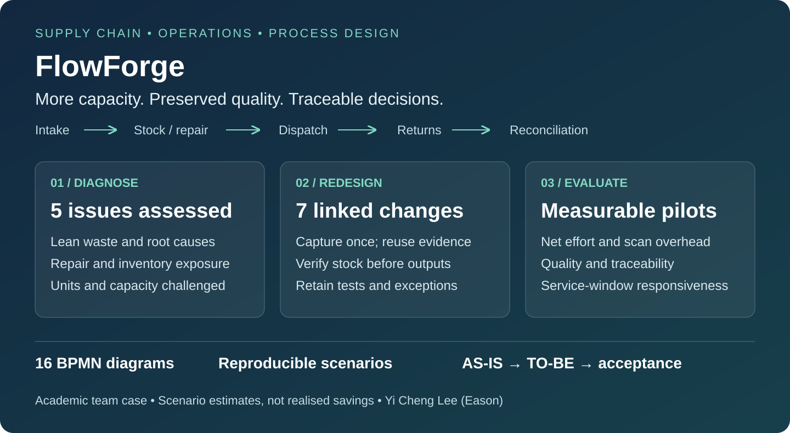

# FlowForge｜供應鏈流程改善作品集

**維修營運・庫存管理・逆向物流・Lean 分析・SAP Signavio・BPMN 2.0**

這個案例探討：零組件維修企業如何在維持維修品質、庫存可追溯性與服務承諾的前提下，釋出承接更多客戶的營運能力。

我參與了團隊專案的**流程分析、AS-IS／TO-BE 建模、改善方案設計、量化分析與報告撰寫**。作品集把需求接收、備品分配、維修與外包、出貨、退回及每日盤點串成完整的分析與改善邏輯。

**[English](README.md)・[流程圖](docs/model-gallery.md)・[問題與根因](docs/business-case.md)・[量化分析](docs/quantitative-analysis.md)・[改善方案](docs/redesign.md)**

## 能展示的專業能力

| 能力 | 具體成果 |
| --- | --- |
| 供應鏈與跨部門流程分析 | 區分資訊流、實物流、維修責任與外部合作方，釐清每筆案件、每日控制與跨日異常的邊界 |
| SAP Signavio／BPMN 建模 | AS-IS、TO-BE 各一個主流程與七個子流程，合計 16 張可瀏覽圖，保留 BPMN XML |
| Lean 與根因分析 | 八大浪費、五項問題、前三項優先排序，以及 Process／People／Policies／Systems 根因分析 |
| 量化分析與商業判斷 | 路由數量核對、工時與成本估算、維修期望時間、權重敏感度及掃描負擔的損益平衡 |
| 改善方案與落地規劃 | 七項改善逐一連結問題、流程位置、責任角色、保留控制與驗收條件 |

## 面試時值得討論的三個判斷

1. **釋出產能需要可核對的工作邊界。** 選定的備品／外包出貨族群有 296 分鐘重複紀錄工時，依案例費率相當於 AU$740。改善情境估計可減少其中 266.4 分鐘，相當於 AU$666；仍需扣除自動產出失敗的補救工作。
2. **降低重工不能犧牲品質。** 維修診斷證據足夠時才採取精準處理，否則保留完整診斷；最終測試及重建後複測仍要執行。
3. **數位化也有新增成本。** 在既定情境下，額外掃描每次約 13.15 秒即達損益平衡。因此先測試高風險移轉點，再決定是否縮減原有實體控制。

上述為不同範圍的估算，不能直接相加。160 筆是到件族群的分析基準，不代表一天可以完成 160 筆維修；所有金額都不是已實現的現金節省。

## 建議閱讀順序

先看[商業問題與排序](docs/business-case.md)，再比較[改善前後模型](docs/model-gallery.md)，接著檢查[假設與計算](docs/quantitative-analysis.md)及[KPI／試行驗收](docs/measurement-plan.md)。[面試導覽](docs/interview-guide.md)提供可用來說明分析思路的問答重點。

**專案背景：** 2026 年昆士蘭大學 BISM7216 團隊課程案例，FlowForge 為虛構企業。此處展示的是分析及改善提案，尚無企業實施、實際節省或正式環境績效的證據。原始組員學號、作業題目及評分表未公開；作品集整理、模型預覽與重現工具有 AI 協助。[來源與驗證範圍](docs/evidence/README.md)。
