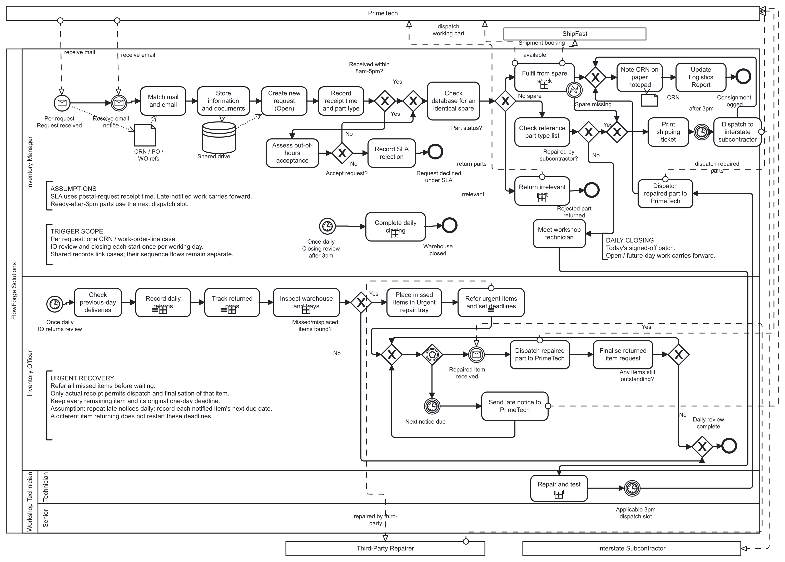
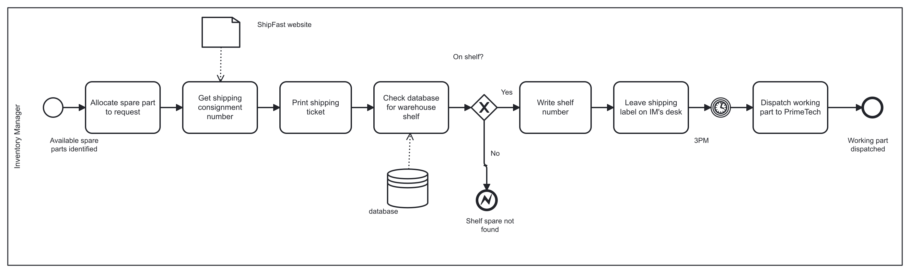
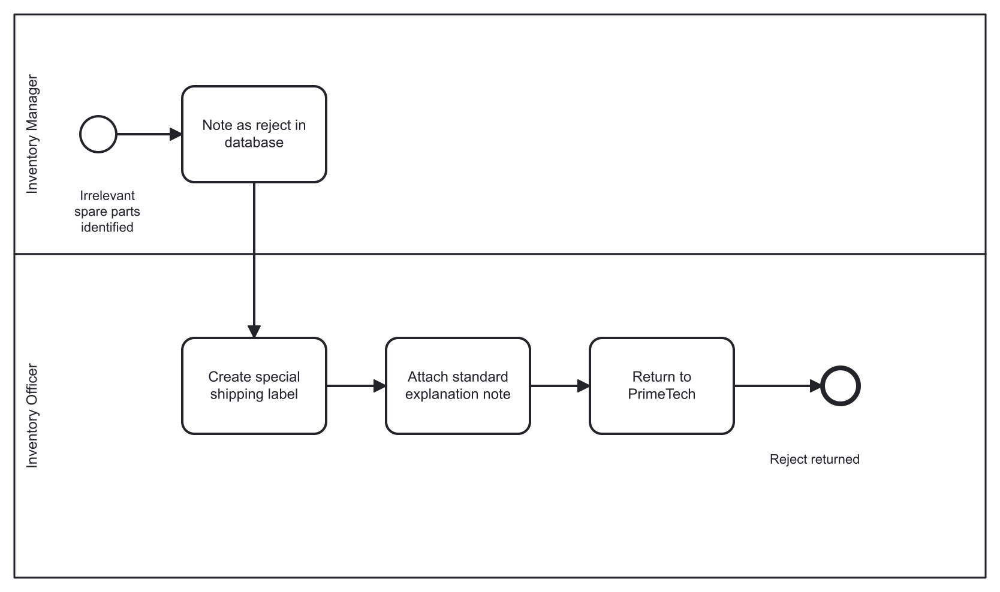
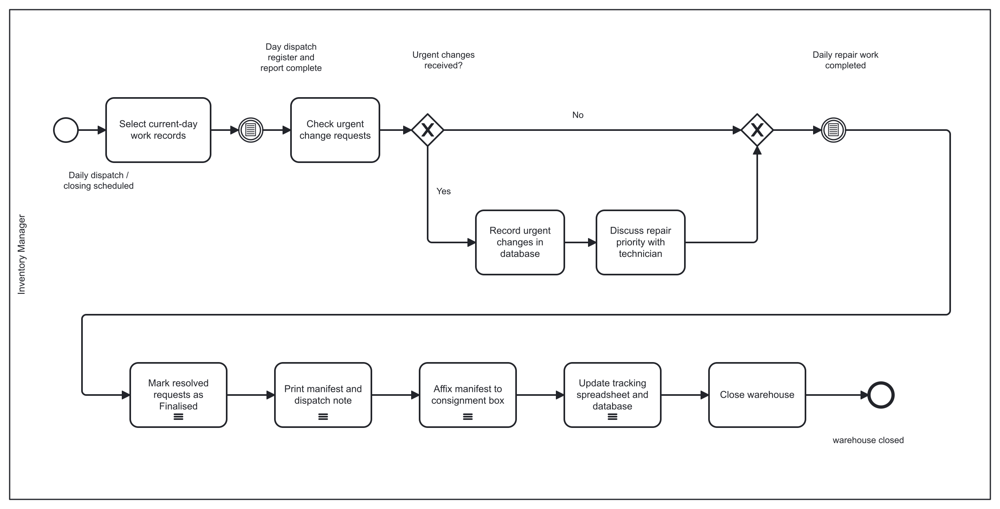
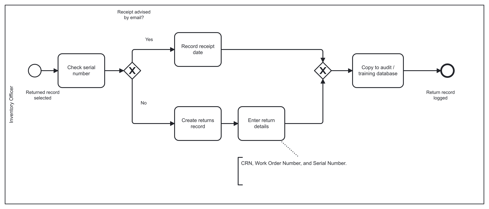
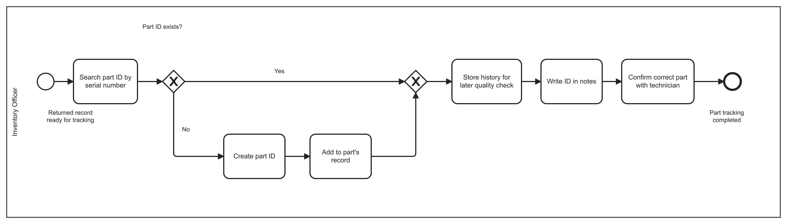
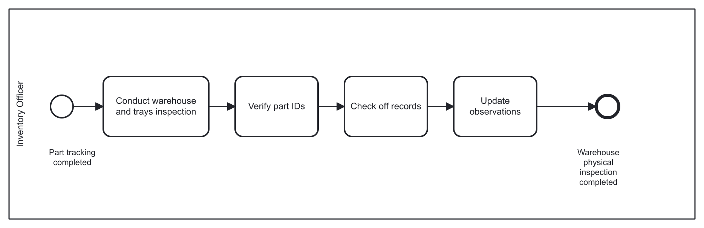
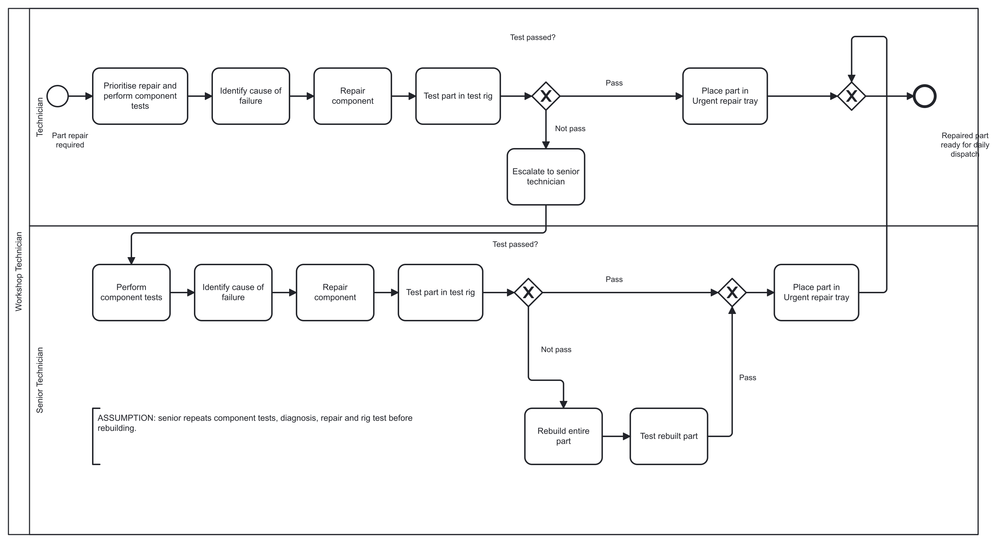
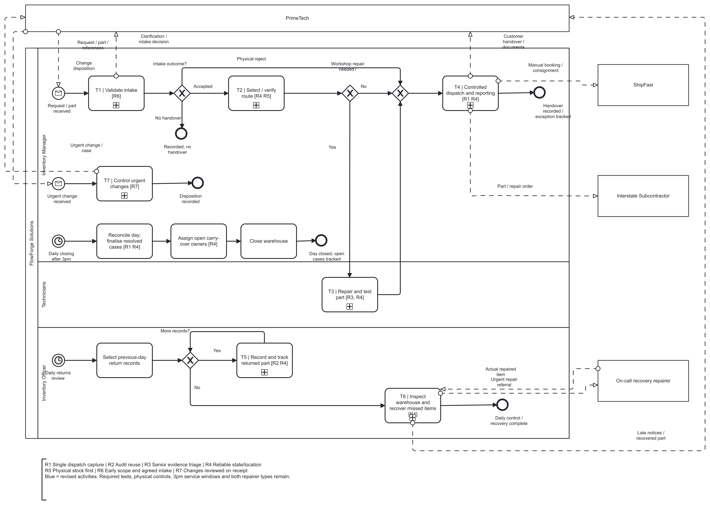

# AS-IS and TO-BE model gallery

[Back to portfolio](../README.md) · [Design rationale](redesign.md) · [Model evidence](evidence/README.md)

Both supplied models contain one overview and seven subprocess diagrams. The previews below preserve the original BPMN diagram layout. They were generated with bpmn-js 18.9.1; they are not new native Signavio screenshots. Open an SVG to zoom into a dense model. Original labels and known convention limitations remain disclosed.

## Compare by business responsibility

| Responsibility | AS-IS | TO-BE | Main changes |
| --- | --- | --- | --- |
| Request and routing | [Overview](#as-is-00), [spare stock](#as-is-01), [physical rejection](#as-is-02) | [Overview](#to-be-00), [T1 intake](#to-be-01), [T2 route](#to-be-02) | R4/R5/R6 |
| Workshop assurance | [Repair and test](#as-is-07) | [T3 repair and test](#to-be-05) | R3/R4 |
| Dispatch and closing | [Spare fulfilment](#as-is-01), [daily closing](#as-is-03) | [T4 dispatch/reporting](#to-be-03), overview closing branch | R1/R4 |
| Returns and identity | [Return recording](#as-is-04), [history tracking](#as-is-05) | [T5 record and track](#to-be-06) | R2/R4 |
| Inspection and recovery | [Warehouse/trays](#as-is-06) | [T6 inspection/recovery](#to-be-07) | R4 |
| Urgent changes | [Daily closing](#as-is-03) | [T7 on-receipt control](#to-be-04) | R7 |

AS-IS and TO-BE use different decomposition boundaries. Matching XML IDs alone does not establish unchanged scope. R tags identify proposed changes in the TO-BE. The preview renderer may differ from native Signavio colour styling; all node coordinates remain as supplied.

## AS-IS

[Download BPMN XML](../models/flowforge-as-is.bpmn)

### AS-IS 0 - FlowForge Solution

Main collaboration and the distinction between request work, daily review and closing.

[Zoom SVG](assets/as-is-00.svg) · [Full PNG](assets/as-is-00.png)

### AS-IS 1 - Fulfil from spare stock

Current ordering: shipping outputs precede the physical shelf check.

[Zoom SVG](assets/as-is-01.svg) · [Full PNG](assets/as-is-01.png)

### AS-IS 2 - Return irrelevant part

Physical out-of-scope return and its required rejection controls.

[Zoom SVG](assets/as-is-02.svg) · [Full PNG](assets/as-is-02.png)

### AS-IS 3 - Complete daily closing

Current daily close, late urgent-change review and record maintenance.

[Zoom SVG](assets/as-is-03.svg) · [Full PNG](assets/as-is-03.png)

### AS-IS 4 - Record daily returns

Advised/unadvised returns and the separate audit/training entry.

[Zoom SVG](assets/as-is-04.svg) · [Full PNG](assets/as-is-04.png)

### AS-IS 5 - Track returned parts

Part-history lookup, legitimate identity creation and technical follow-up.

[Zoom SVG](assets/as-is-05.svg) · [Full PNG](assets/as-is-05.png)

### AS-IS 6 - Inspect warehouse and trays

Recurring physical control and external recovery; actual receipt differs from a timeout.

[Zoom SVG](assets/as-is-06.svg) · [Full PNG](assets/as-is-06.png)

### AS-IS 7 - Repair and test part

Technician work, Senior escalation and bounded rebuild/retest.

[Zoom SVG](assets/as-is-07.svg) · [Full PNG](assets/as-is-07.png)

## TO-BE

[Download BPMN XML](../models/flowforge-to-be.bpmn)

### TO-BE 0 - M0 / FlowForge TO-BE overview

Main collaboration; daily closing and recovery have separate completion boundaries.

[Zoom SVG](assets/to-be-00.svg) · [Full PNG](assets/to-be-00.png)

### TO-BE 1 - T1 / Validate intake [R6]

R6: agreed record authority, legacy evidence, correlation and human clarification.

[Zoom SVG](assets/to-be-01.svg) · [Full PNG](assets/to-be-01.png)

![TO-BE - T1 / Validate intake [R6]](assets/to-be-01.png)

### TO-BE 2 - T2 / Select / verify route [R4 R5]

R4/R5: reserve and verify the physical spare before T4 creates shipping outputs.

[Zoom SVG](assets/to-be-02.svg) · [Full PNG](assets/to-be-02.png)

![TO-BE - T2 / Select / verify route [R4 R5]](assets/to-be-02.png)

### TO-BE 3 - T4 / Controlled dispatch and reporting [R1 R4]

R1/R4: prepare required documents, record actual handover, derive outputs and recover failures.

[Zoom SVG](assets/to-be-03.svg) · [Full PNG](assets/to-be-03.png)

![TO-BE - T4 / Controlled dispatch and reporting [R1 R4]](assets/to-be-03.png)

### TO-BE 4 - T7 / Control urgent changes [R7]

R7: correlate the existing case and distinguish active work from post-dispatch disposition.

[Zoom SVG](assets/to-be-04.svg) · [Full PNG](assets/to-be-04.png)

![TO-BE - T7 / Control urgent changes [R7]](assets/to-be-04.png)

### TO-BE 5 - T3 / Repair and test part [R3, R4]

R3/R4: review evidence, retain full diagnostics and final tests, then capture completion.

[Zoom SVG](assets/to-be-05.svg) · [Full PNG](assets/to-be-05.png)

![TO-BE - T3 / Repair and test part [R3, R4]](assets/to-be-05.png)

### TO-BE 6 - T5 / Record and track returned part [R2 R4]

R2/R4: reuse verified return data with output acknowledgement, correction and identity controls.

[Zoom SVG](assets/to-be-06.svg) · [Full PNG](assets/to-be-06.png)

![TO-BE - T5 / Record and track returned part [R2 R4]](assets/to-be-06.png)

### TO-BE 7 - T6 / Inspect warehouse and recover missed items [R4]

R4: physical controls, discrepancy ownership and recovery until actual receipt and dispatch.

[Zoom SVG](assets/to-be-07.svg) · [Full PNG](assets/to-be-07.png)

![TO-BE - T6 / Inspect warehouse and recover missed items [R4]](assets/to-be-07.png)

## Import and inspect

Download a BPMN file and import it into an authorised SAP Signavio workspace using BPMN 2.0 XML import. Inspect the overview and all seven subprocesses, read task documentation and run the workspace syntax and convention checks. Preserve warnings rather than treating a successful import or a preview without renderer warnings as full validation.

For the current verification scope and known naming/outcome/message-replication limitations, see [provenance and checks](evidence/README.md).
